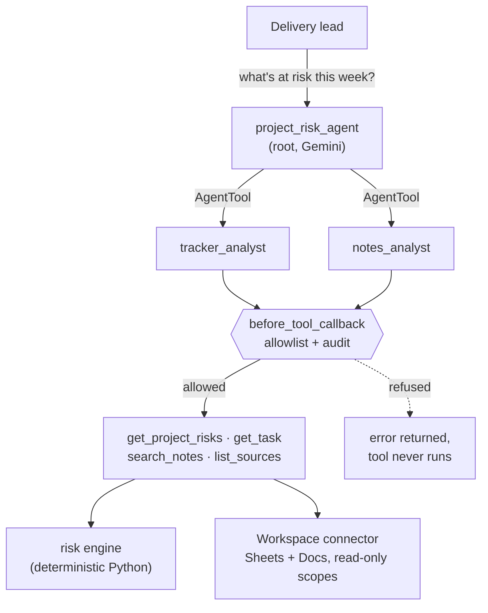

# Project Risk Agent

[](https://github.com/eswar-varun/workspace-risk-agent/actions/workflows/ci.yml)


[](LICENSE)

A multi-agent assistant, built with Google's **Agent Development Kit (ADK)** and **Gemini**,
that reads a project tracker in **Google Sheets** and meeting notes in **Google Docs** and
answers *"what's at risk, and why?"*: overdue and blocked work, dependency chains and cycles,
stale tasks, overloaded owners.

It's read-only by construction. Every file access goes through a code-enforced allowlist, and
every tool call is audited.



## What it does

| Ask | It answers with |
|---|---|
| "What's at risk this week?" | Ranked risks, each with task ID, owner, reason and suggested next step, plus context quoted from the notes with links |
| "Why is PAY-7 late?" | Its full upstream chain: it waits on PAY-6 → PAY-5 → PAY-4, which is blocked on vendor credentials |
| "Draft an escalation for payments" | A draft message for you to send. The agent can't send anything |

On the bundled demo data, the deterministic engine finds (`python -m risk_agent risks`, excerpt):

```
[CRITICAL] PAY-4    Meera    4 day(s) past its due date (2026-10-09); marked Blocked; no update for 10 days
[CRITICAL] PLAT-12  Priya    due 2026-10-14 but depends on PLAT-13 (due 2026-10-21); part of a dependency cycle ...
[HIGH    ] PAY-5    Meera    waiting on PAY-4, which is blocked or overdue; no update for 10 days
[HIGH    ] ONB-8    Sneha    3 day(s) past its due date (2026-10-10)
[MEDIUM  ] ONB-14   Arjun    depends on PAY-99, which is not in the tracker
[CYCLE   ] PLAT-12 -> PLAT-13 -> PLAT-12
[OVERLOAD] Sneha: ONB-8, ONB-9, ONB-10, ONB-11 due within the horizon
```

## Design principles

- **The model explains; code computes.** Dates, dependency graphs, cycles and rankings are
  computed in tested Python ([`risks.py`](risk_agent/risks.py)). Gemini interprets and
  prioritises, and is told never to redo the arithmetic.
- **Least privilege, enforced in code.** OAuth scopes are `spreadsheets.readonly` and
  `documents.readonly`, and no tool can write, share or send. An ADK `before_tool_callback`
  refuses any file not on the allowlist before the tool runs, so an instruction planted in a
  document can't make the agent open another file.
- **Untrusted content stays data.** Document text is passed back with an explicit notice, and
  every prompt says instructions inside documents must not be followed. The demo notes contain
  a planted injection to test exactly that.
- **Auditable.** Each tool call logs one JSON line: agent, tool, arguments, decision
  (allowed or refused), outcome and duration.
- **Testable offline.** 66 tests run with no network or keys: the Google connector against
  Google's bundled API definitions with recorded HTTP, and the full agent tree through ADK's
  runner with a scripted stand-in for Gemini.

Details: [docs/DESIGN.md](docs/DESIGN.md) · [docs/FAQ.md](docs/FAQ.md)

## Quickstart

```bash
python -m venv .venv
source .venv/bin/activate         # Windows: .venv\Scripts\activate
pip install -e ".[dev]"

# The risk engine and tools, no model or key needed:
RISK_AGENT_TODAY=2026-10-13 python -m risk_agent risks
python -m risk_agent task PAY-7
python -m risk_agent search "PAY-4 vendor"

# The agent, with Gemini (free key from https://aistudio.google.com/apikey):
export GEMINI_API_KEY=...
adk web          # chat UI with traces of every agent and tool call
adk run risk_agent
```

To point it at your own Google Sheet and Doc, see [docs/SETUP.md](docs/SETUP.md). It takes
about 15 minutes: a read-only service account, then share the two files with it.

## Tests

```bash
pytest           # 66 tests, offline
ruff check .
```

| Area | What's covered |
|---|---|
| Risk engine | every risk type and its boundaries, transitive propagation, cycles (including a 3,000-task chain), ranking |
| Tracker parsing | header aliases, serial and ISO dates, ambiguous dates refused, bad rows reported as data issues |
| Google connector | real request building (render options, ranges), Docs parsing, 403/404 explained |
| Guardrails | allowlist, refusal before execution, audit records |
| Agent | root → specialists → tools end to end; a refused file never reaches the connector; no write tools exist |

## Status and roadmap

| | |
|---|---|
| ✅ | Multi-agent ADK tree, deterministic risk engine, read-only Sheets and Docs connector, allowlist and audit callbacks, offline test suite, demo data |
| ⏳ | Evaluation set run against live Gemini (answer quality, tool choice, injection resistance) |
| ⏳ | Image input: reconcile a photo of a whiteboard or status board with the tracker |
| ⏳ | Deploy to Cloud Run (`adk deploy cloud_run`) and register in Gemini Enterprise |

## License

MIT
